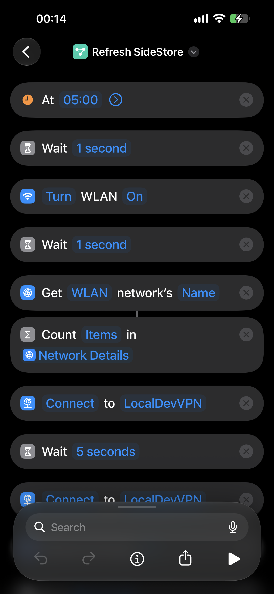
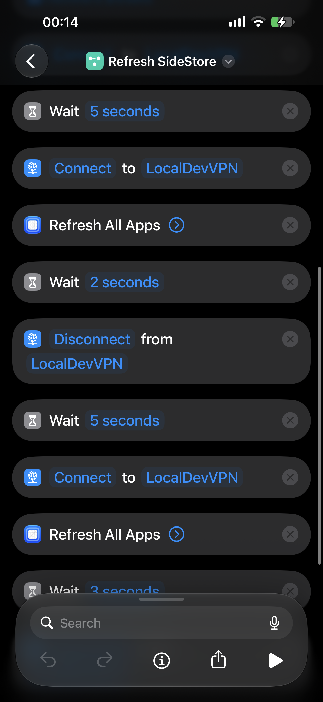
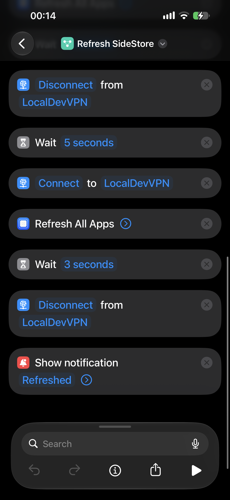
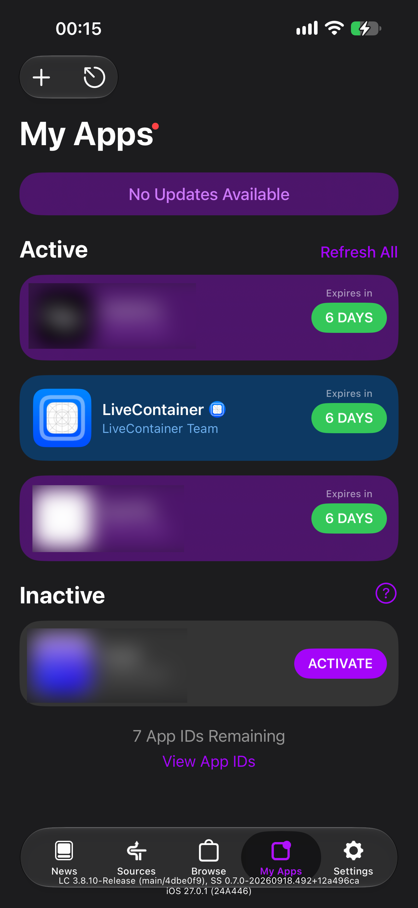
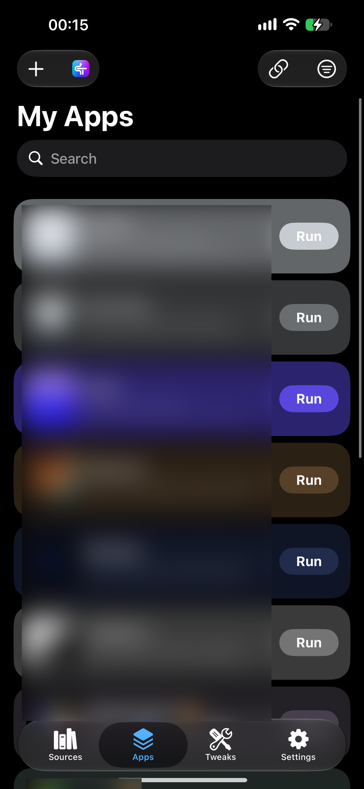

# iPhone sideloading that renews itself: SideStore + LiveContainer + an iOS Shortcut

How I installed apps outside the App Store on an iPhone without a paid developer account and without a jailbreak, and then automated the part that kept annoying me: the 7-day expiry.

## The problem

I moved from Android, where you can install any `.apk`. I wanted the same on iPhone. The official ways are paid (an Apple Developer account costs more than I could justify). I tried the free alternatives one after another, and each one fixed one weakness and exposed the next.

## The path, in order

| Step | Tool | What it solved | What was still wrong |
|---|---|---|---|
| 1 | Leaked enterprise certificates | Free and instant | Apple revokes them quickly, and I did not want to trust unknown certificates with my phone. I stopped using them |
| 2 | **AltStore** | Works with a free Apple ID | Free accounts allow **3 active apps**, and AltStore itself counts as one, so really 2. Renewing every 7 days needs a PC |
| 3 | **SideStore** | After the first install from a PC, renewals happen on the phone | Same 3-app limit. I had to remember to turn on a local VPN, open SideStore, wait for the timer and turn the VPN off |
| 4 | **iOS Shortcut + Automation** | Renewal without me | Still only 2 free slots |
| 5 | **LiveContainer** | Runs many apps *inside one app*, so the 3-app limit stops mattering (only one app runs at a time) | SideStore took one slot and LiveContainer took another, leaving one for me |
| 6 | **LiveContainer + SideStore in one app** (the [LiveContainer](https://github.com/LiveContainer/LiveContainer) project ships a build with SideStore included, besides the LiveContainer-only build) | One app does both jobs | Nothing important. 2 free slots, unlimited apps inside LiveContainer, automatic renewal |

## How it works (in my words)

- **Free Apple ID signing.** A free Apple ID can sign apps for development, but the signature lasts only **7 days**. After that the app stops opening until it is signed again. That is Apple's rule, not a bug. A free account also has a limit on how many App IDs it may create per week.
- **SideStore renews on the phone.** AltStore needs a computer to be present on the network when it signs. SideStore removes that: it uses a **local VPN profile (LocalDevVPN)** that loops traffic back to the phone itself, so the phone believes a computer is there, and signs the apps on the device. Without the local VPN on, the refresh fails.
- **LiveContainer works like a container.** It is one signed app that can keep and launch other apps inside it, similar in spirit to Docker. Only one inner app runs at a time, but the number of apps is no longer limited by Apple's 3-app rule.

## The automation

The refresh needs the local VPN to be on, so by hand it was: turn VPN on, open SideStore, wait for the timer, close it, turn VPN off. I forgot it, or I was too lazy.

I built an **iOS Shortcut** called "Refresh SideStore" that does exactly that, and a **Personal Automation** that runs it **every day at 05:00**. I picked that time because I am asleep and the phone is not in use. At any other time the refresh could be interrupted by whatever I was doing.

What the shortcut does:

1. Turns Wi-Fi on and checks that the phone is connected to a network.
2. Connects to the local VPN (**LocalDevVPN**) and waits a few seconds so it comes up.
3. Runs **Refresh All Apps** (an action that SideStore provides to Shortcuts).
4. Waits, disconnects, reconnects and tries again. It makes several attempts as a safety net: sometimes a refresh simply does not start on the first try.
5. Disconnects the VPN and shows the notification "Refreshed".

The screenshots of the whole shortcut are below.

| Start | Middle | End |
|---|---|---|
|  |  |  |

Result: all apps show **6 days** left in SideStore, because they were renewed the day before. I have not had to think about the 7-day limit since.

| SideStore (apps and expiry) | LiveContainer (apps inside it) |
|---|---|
|  |  |

App names are blurred on purpose. They are not important to the setup.

## What I took from it

- Reading the **limits** of a system (3 apps, 7 days, a weekly App ID quota) and finding the tool that goes around each, instead of looking for one trick.
- Why a local VPN can be useful for something that has nothing to do with privacy.
- **Automating a boring chore** until it disappears. The best result here is that I forgot the problem existed.
- Choosing a time for a scheduled job so it does not collide with real use.

## Notes

- This uses the normal development signing that Apple provides for free Apple IDs. It is not a jailbreak and does not change the system, so it carries no risk to the device. It does not give a way to get paid apps for free, and I do not use it for that.
- LiveContainer and SideStore are open-source projects by other people. I did not write them; I combined them and built the automation around them.
- Tool versions in the screenshots: LiveContainer 3.8.10 and SideStore 0.7.0. These tools change quickly, so check the current instructions of each project before copying anything.
- I did not publish my Apple ID, device identifiers or the pairing file. They stay private.
